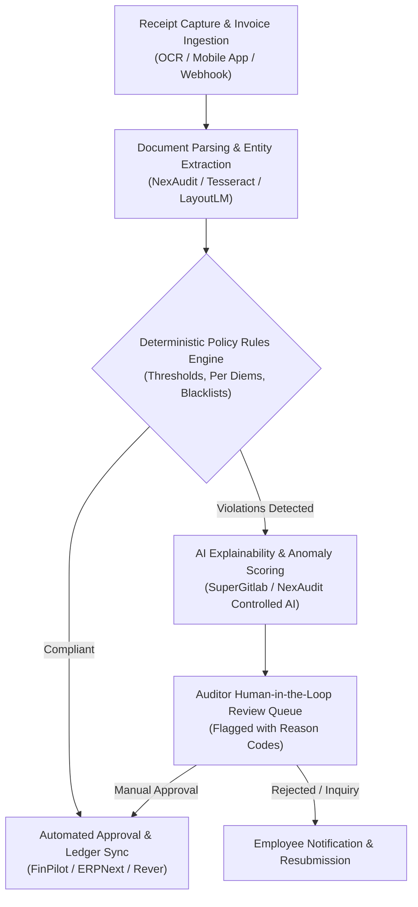

  

# 💸 Awesome Corporate Expense Policy Auditing Systems 🔍

  
  
  
  
  

> 🚀 **A curated directory of enterprise SaaS platforms, AI-driven spend governance tools, and open-source corporate expense policy auditing systems** designed for real-time policy enforcement, automated compliance checks, duplicate detection, and financial risk intelligence.

---

## 📑 Table of Contents

- [📊 Sector Overview & Market Dynamics](#-sector-overview--market-dynamics)
- [🏢 Enterprise SaaS & Hosted Platforms](#-enterprise-saas--hosted-platforms)
- [💻 Open-Source GitHub Projects](#-open-source-github-projects)
- [🧰 Additional Open-Source Tools & Libraries](#-additional-open-source-tools--libraries)
- [🏗️ Architecture Blueprint for Custom Auditing](#️-architecture-blueprint-for-custom-auditing)
- [🤝 How to Contribute](#-how-to-contribute)
- [📈 Star History](#-star-history)
- [💖 Support](#-support)
- [⚖️ Disclaimer & Best Practices](#️-disclaimer--best-practices)

---

## 📊 Sector Overview & Market Dynamics

The global Corporate Travel & Expense (T&E) and spend management software sector is valued between **$3.8 billion and $5.4 billion** and is projected to exceed **$11 billion by the early 2030s**, growing at a compound annual growth rate (CAGR) of 11%–16%. 📈

The market remains **moderately to highly fragmented** rather than a winner-take-all monopoly: legacy enterprise ERP giants (SAP Concur, Coupa) anchor Fortune 500 workflows, specialized AI audit intelligence layers (AppZen, Oversight) monitor cross-system risks, and agile fintech unicorns (Ramp, Brex, Navan) drive rapid consolidation across mid-market corporate cards and real-time pre-spend authorization. 🌐

---

## 🏢 Enterprise SaaS & Hosted Platforms

Corporate expense policy auditing platforms compare employee spending against internal policies, receipt evidence, and tax regulations in real time. The table below outlines the category leaders, sorted in descending order by enterprise size (valuation / revenue scale): 🏷️

| Platform | Company Size (Valuation / Revenue) | Starting Pricing Tier | Free Tier & Trial Limits | Core Auditing & Policy Capabilities |
| :--- | :--- | :--- | :--- | :--- |
| **[SAP Concur](https://www.concur.com/)** | **$8.3B** acquisition by SAP SE (~$36B+ Cloud ERP revenue) | **$7.00** per expense report (*Base plan*, unlimited users) | **No self-serve free tier**; guided live interactive demo & proof-of-concept sandbox available upon sales request. | 🛡️ Native enterprise T&E compliance engine, automated policy exception flags, OCR receipt verification, and Concur Detect AI anomaly audits. |
| **[Coupa](https://www.coupa.com/)** | **$8.0B** valuation (acquired by Thoma Bravo; ~$800M+ ARR) | **~$2,500/mo** (typical mid-market starting tier entry, ~$15k–$30k/yr) | **No free tier** for buyer platform; free supplier portal available; 30-day guided enterprise PoC through sales. | 📑 Comprehensive Business Spend Management (BSM), pre-spend approval workflows, fraud detection, and AI-powered contract/expense policy enforcement. |
| **[Navan](https://navan.com/)** | **$6.1B** market cap (Nasdaq: NAVN; ~$860M revenue) | **$15.00** per active user/month (for expense module beyond free tier) | **Free forever for first 5 active users/month** (for companies ≤300 employees); unlimited free travel booking. | ✈️ Dynamic market-rate travel caps, automated receipt matching, custom booking policy rules, and proactive out-of-policy approval workflows. |
| **[Brex](https://brex.com/)** | **$5.15B** valuation (acquired by Capital One; ~$500M+ ARR) | **$12.00** per user/month (*Premium plan*; custom for Enterprise) | **Free forever plan (Essentials)**: supports up to 2 legal entities, basic AI spend rules, global cards, and standard accounting sync. | 💳 Real-time card authorization restrictions, autonomous receipt reconciliation, custom manager approval hierarchies, and multi-currency expense controls. |
| **[Emburse](https://www.emburse.com/)** | **$1.0B+** valuation (~$300M+ annual revenue; K1 Investment) | **$8.00** per user/month (*Emburse Spend*, 15-user min floor = $120/mo) | **30-day free trial** available for Emburse Spend (full card controls and expense workflows without initial lock-in). | 📱 Emburse Assurance AI compliance add-on, proactive warnings during mobile receipt capture, multi-language OCR (32 languages), and synthetic receipt detection. |
| **[AppZen](https://www.appzen.com/)** | **$500M+** valuation (Series D; ~$95M ARR) | **~$3.00** per employee/month (enterprise contracts start ~$25,000/yr) | **No public free tier**; offers tailored sandbox product evaluations and historical expense audit sample runs upon request. | 🤖 Market pioneer in AI expense auditing; inspects 100% of receipts before reimbursement, validates IRS/HMRC cross-border compliance, and detects duplicate/out-of-policy claims. |
| **[Airbase (Paylocity)](https://www.airbase.com/)** | **$325M** acquisition by Paylocity (~$70M ARR) | **Custom quote** (historically ~$350/mo base for growth tiers) | **Free baseline tier** available for early-stage startups and small businesses (free bill pay, basic approvals, and card issuing). | 🔐 Advanced purchase approvals with contingent multi-department routing (e.g., IT/Security signoff), virtual card authorization limits, and dual-entry accounting sync. |
| **[Expensify](https://www.expensify.com/)** | **$210M** market cap (Nasdaq: EXFY; ~$140M TTM revenue) | **$5.00** per member/month (*Collect plan*; $9/member/month for *Control plan*) | **Free forever plan**: unlimited SmartScan receipt OCR for individuals; free 6-week workspace onboarding trial for teams. | 🧾 Workspace Rules with merchant-category blocking, authorization-time card declines, AI Agent Rules for natural language routing, and multi-tier manager approvals. |
| **[Oversight](https://www.oversight.com/)** | **~$200M–$300M** estimated valuation (TCV majority backed; ~$45M ARR) | **Custom enterprise contract** (scales by transaction volume, typically $30k+/yr) | **No self-serve free tier**; custom ROI proof-of-value analysis conducted using historical company transaction data. | 🔎 Enterprise Finance Risk Intelligence (FRI) across T&E, P-Cards, and AP; detects forged receipts, splits, and duplicate invoices with 96%–99% automated ML accuracy. |
| **[Ramp](https://ramp.com/)** | **High-Growth Fintech Leader** (scales via card interchange volume) | **$15.00** per user/month (*Ramp Plus*; custom for Enterprise) | **Free forever core plan**: $0/mo/user with corporate cards, receipt matching, bill pay, accounting sync, and automated policy controls. | ⚡ Real-time card transaction enforcement, automated receipt matching via SMS/email, dynamic per-diem category limits, and vendor-level restrictions. |

---

## 💻 Open-Source GitHub Projects

For organizations requiring self-hosted infrastructure, data sovereignty, explainable deterministic rule engines, or cost-effective compliance pipelines, these open-source tools offer robust building blocks. 🛠️

Sorted in descending order by GitHub Stars: ⭐

| Project | GitHub Stars | License | Description & Auditing Strengths |
| :--- | :---: | :---: | :--- |
| **[frappe/erpnext](https://github.com/frappe/erpnext)** |  | GPL-3.0 | 🏢 Full-featured ERP system featuring comprehensive Expense Claim modules, customizable multi-level approval matrices, cost center budget limits, and audit trails. |
| **[invoiceninja/invoiceninja](https://github.com/invoiceninja/invoiceninja)** |  | Elastic License 2.0 | 🧾 Leading self-hosted invoice and expense tracking application with receipt capture, vendor management, currency conversion, and automated category matching. |
| **[Expensify/App](https://github.com/Expensify/App)** |  | MIT | 💬 The open-source client codebase behind New Expensify. Modern cross-platform architecture supporting receipt scanning, chat-driven expense reporting, and workspace policy rules. |
| **[bigcapitalhq/bigcapital](https://github.com/bigcapitalhq/bigcapital)** |  | AGPL-3.0 | 📊 Modern open-source accounting suite featuring built-in expense management, role-based access control, transaction categorization, and financial report validation. |
| **[makerever/rever](https://github.com/makerever/rever)** |  | Apache-2.0 | 🤖 Open-source AI finance agent that audits ledgers in real time. Features 2-way bill-to-PO matching, duplicate bill detection on ingestion, and multi-tier approval routing. |
| **[Abhinavhaldiya/FinPilot](https://github.com/Abhinavhaldiya/FinPilot)** |  | MIT | 🎯 Enterprise-grade expense approval system with role-based routing (Employee, Manager, HR, Finance), threshold-based approval chains, receipt OCR, and immutable audit logging. |
| **[mscbuild/nanoagent-compliance-hub](https://github.com/mscbuild/nanoagent-compliance-hub)** |  | MIT | 🕵️ Multi-agent expense auditing platform demonstrating autonomous compliance checks, automated anomaly detection, and human-in-the-loop review queues. |
| **[SuperGitlab/ai-expense-auditor](https://github.com/SuperGitlab/ai-expense-auditor)** |  | Apache-2.0 | 🧠 AI-driven expense reimbursement auditor combining LangGraph multi-agent orchestration, RAG on company policy manuals, and deterministic rule validation. |
| **[Edd1eOS/NexAudit](https://github.com/Edd1eOS/NexAudit)** |  | MIT | ⚡ Lightweight, explainable expense auditor combining OCR and a JSON rule engine. Flags duplicate submissions, tax calculation errors, and threshold violations with explicit explanations. |
| **[zemio-co/zemio](https://github.com/zemio-co/zemio)** |  | MIT | 🏛️ Self-hostable expense tracker with multi-tenant permissions, Microsoft OAuth integration, multi-stage approval lifecycles, and cost unit budget tracking. |
| **[noahcoffey/CashFlow](https://github.com/noahcoffey/CashFlow)** |  | MIT | 💻 Local-first financial application with a regex-capable conditional rules engine for auto-categorization and transaction policy evaluation. |
| **[pakagronglb/python-finance-automation](https://github.com/pakagronglb/python-finance-automation)** |  | MIT | 🐍 Python automation script suite for transaction keyword categorization, recurring expense identification, and budget monitoring. |

---

## 🧰 Additional Open-Source Tools & Libraries

- **[finn-tracker](https://pypi.org/project/finn-tracker/)** 📦 — Local expense engine featuring 200+ rule presets across 15 categories with custom rule persistence and MCP server support for LLMs.
- **[canhoto](https://pypi.org/project/canhoto/)** 🧩 — Rule-driven expense categorization library supporting regex rules, threshold filters, and persistent merchant memory.
- **[n8n Workflow Templates](https://n8n.io/)** 🔄 — Open-source automation workflows connecting OCR webhooks to Slack/Teams alerts for out-of-policy expense submissions.

---

## 🏗️ Architecture Blueprint for Custom Auditing

Engineering teams seeking to build a custom, vendor-independent expense auditing platform can combine best-of-breed open-source modules: 📐

1. **📥 Ingestion & Extraction:** Extract vendor, transaction date, line items, and tax via **NexAudit OCR** or **Expensify/App**.
2. **⚖️ Deterministic Validation:** Enforce strict per-diem limits, receipt requirements, and merchant categories before invoking AI.
3. **🔄 Approval Lifecycle & Settlement:** Route flagged exceptions through **FinPilot** or **ERPNext** multi-stage approval hierarchies.
4. **🔗 PO & Duplicate Matching:** Utilize **Rever** for two-way invoice-to-PO reconciliation and historical ledger checks.

---

## 🤝 How to Contribute

We welcome additions of new tools, rule engines, and case studies! 🌟

1. Fork this repository. 🍴
2. Add or update entries following the established table schema and badge conventions. 📝
3. Ensure all links point to authoritative platform sites or GitHub repositories. 🔗
4. Open a Pull Request with a clear summary of your changes. 🚀

---

## 📈 Star History

---

## 💖 Support

Thank you for visiting and using this resource! 🙏 If you find this curated list valuable for your research, team, or project:

- ⭐ **Star this repository** to help others discover it!
- 🍴 **Fork and share** it with your fellow engineering, finance, and auditing teams!
- ☕ **Buy a coffee & sponsor**: Support continuous maintenance and curated open-source research via the [GitHub Sponsors Dashboard](https://github.com/sponsors/ishandutta2007).

---

## ⚖️ Disclaimer & Best Practices

- 🔒 **Regulatory Compliance:** Expense auditing software handles confidential personal and financial data. Self-hosted deployments must adhere to GDPR, CCPA, PCI-DSS, and internal financial controls (SOX Section 404).
- ⏱️ **Enforce Real-Time Over Post-Reimbursement:** Frontline prevention (at authorization or mobile receipt capture) saves up to 70% of auditing overhead compared to retroactive quarterly audits.
- 🛡️ **AI Receipts & Synthetic Fraud:** As generative AI receipt generation evolves, combine metadata validation (EXIF inspection, vendor merchant ID checks) with deterministic OCR cross-referencing.
- 🎯 **Clarify Policy Ambiguity:** Data shows that most expense flags stem from ambiguous policy language (e.g., "reasonable dinner expenses") rather than malicious intent. Codify quantitative limits into your rule engines.

---

  Curated with precision for finance leaders, internal auditors, CFOs, and software engineers building transparent spend compliance infrastructure. 💼✨

